  

  <h3>Si ça n'existe pas, je le monte. Si ça casse, je le répare.</h3>
  
Pour Windows, en local, sans compte. Et sans demander la permission au cloud.

 

### La maison

- **Local d'abord** : tes fichiers restent sur ton disque, pas dans le nuage d'un autre.
- **Zéro compte** : aucun « créez un compte pour continuer ».
- **Une chose, bien** : pas de couteau suisse à deux cents lames.
- **Gratuit** : pas d'abonnement, pas de version « Pro » qui cache le bon bouton.

### Sorti de l'atelier

| Projet | Ce qu'il fait | En vrai |
| --- | --- | --- |
| **[Synk](https://github.com/WoldenMn/synk)** | Réunit montres, bagues et exports santé dans une seule appli de bureau. | Tes données de santé restent chez toi. Même pas chez moi. |
| **[Wintyx](https://github.com/WoldenMn/wintyx)** | Analyse, nettoie, optimise et durcit Windows 10 et 11. | Le grand ménage, sans les « optimiseurs » louches qui s'installent tout seuls. |
| **[ClipForge](https://github.com/WoldenMn/ClipForge)** | Découpe une longue vidéo en clips verticaux sous-titrés. | Trois heures de vidéo, les trente secondes qui comptent. |

 

  Un souci ? Signale-le sur le dépôt concerné. Un compliment ? Pareil, ça marche aussi.

